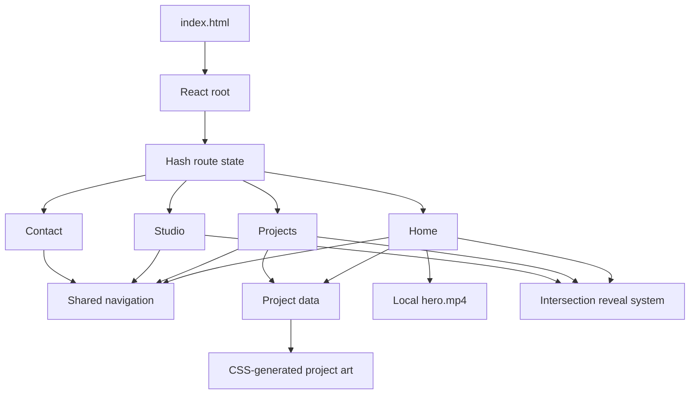

<div align="center">

# Foldcraft.

### Ideas made tangible.

An expressive, motion-led portfolio for an independent creative studio working across identity, digital experiences, art direction, and moving image.

<p>
  <a href="#-quick-start"><strong>Run locally</strong></a>
  ·
  <a href="#-experience"><strong>Explore the experience</strong></a>
  ·
  <a href="#-customization-map"><strong>Customize</strong></a>
</p>


</div>

---

## ✦ Overview

Foldcraft is a responsive studio portfolio built as a compact React experience. It begins with a cinematic, full-viewport video hero and develops into an editorial sequence of studio positioning, selected concept work, capabilities, process, and contact.

The visual system pairs oversized typography and warm neutral surfaces with acid green, persimmon, deep forest, and lilac. CSS-built artwork gives each project its own visual world without adding image dependencies. Motion is used as a narrative layer: staggered entrances, intersection-based reveals, a moving type rail, rotating seals, drifting forms, project hovers, and a full-screen mobile menu.

> [!NOTE]
> Aether, Monogram, and Forma are **independent concept studies**. They are presented as creative explorations and do not imply client engagements.

## ◼ Experience

### Home

The landing page is designed as a sequence rather than a collection of generic blocks:

1. **Cinematic hero** — local looping video, bold positioning, primary call to action, studio seal, and editorial metadata.
2. **Motion rail** — an animated manifesto connecting the hero to the page narrative.
3. **Studio statement** — large typographic belief statement and short introduction.
4. **Selected explorations** — two visual concept studies with animated hover cues.
5. **Capabilities** — a high-contrast service section with a sticky introduction on larger screens.
6. **Closing invitation** — a vivid contact moment built around “Let’s unfold something new.”

### Projects

A long-form project index for three concept studies:

| Project | Discipline | Scope |
|---|---|---|
| **Aether** | Identity / Packaging | Strategy, visual identity, packaging |
| **Monogram** | Editorial / Digital | Art direction, digital, motion |
| **Forma** | Campaign / Motion | Concept, campaign, motion |

Every project visual is rendered in HTML and CSS. This keeps the studies responsive and allows the compositions to animate naturally at different viewport sizes.

### Studio

The studio page explains Foldcraft’s point of view through:

- an abstract brand composition;
- a concise studio narrative;
- three working principles: listen closely, explore freely, and make with intent;
- a direct route into the contact experience.

### Reach Us

The contact page includes a prominent email action, clipboard support, an email fallback, and a responsive abstract orbit composition.

## ◎ Visual language

| Token | Value | Role |
|---|---:|---|
| Ink | `#191915` | Primary typography and dark surfaces |
| Paper | `#F5F4EF` | Main editorial background |
| Signal | `#D8ED5D` | Brand accent and interactive emphasis |
| Persimmon | `#E75D38` | Closing contact section |
| Forest | `#151916` | Service section and cinematic contrast |
| Lilac | `#D1C1EE` | Forma concept world |

The interface uses **Geist** for its main voice, with selective Georgia italics as an editorial counterpoint. Geist is loaded from Google Fonts in `index.html` and exposed through Tailwind as `font-geist`.

## ✺ Motion system

Motion supports hierarchy and pacing throughout the site:

- `fadeSlideUp` introduces the hero in timed stages;
- `IntersectionObserver` triggers one-time content reveals as sections enter the viewport;
- the manifesto rail loops horizontally;
- the Foldcraft seal rotates independently around its center mark;
- project visuals use CSS transforms, gradients, and orbit animation;
- service rows and project cards respond to pointer interaction;
- the mobile menu transitions through height, opacity, rotation, scale, and staggered link timing.

Visitors who request reduced motion are respected through `prefers-reduced-motion`: animations and transitions collapse to near-instant states, while revealed content remains visible.

## ⚡ Quick start

### Requirements

- Node.js
- npm

### Install and run

```bash
npm install
npm run dev
```

Vite will print the local URL in the terminal. Open it in a browser to explore the site.

### Production build

```bash
npm run build
```

The optimized output is written to `dist/`.

## ↗ Routes

Foldcraft uses a lightweight, typed hash router implemented in `src/hooks/useRoute.ts` and composed in `src/App.tsx`.

| View | Route |
|---|---|
| Home | `/` |
| Projects | `/projects` |
| Studio | `/studio` |
| Reach Us | `/contact` |

Hash routing keeps deployment simple because every view is served from the same HTML document and does not require server-side rewrite rules.

## ⌁ Project structure

```text
Foldcraft/
├── public/
│   └── hero.mp4           # Local background video
├── src/
│   ├── components/        # Shared navigation, UI, and project visuals
│   ├── data/              # Typed navigation, project, and studio content
│   ├── hooks/             # Hash route state
│   ├── pages/             # Home, Projects, Studio, and Contact views
│   ├── types/             # Shared TypeScript models
│   ├── App.tsx            # Route composition and document titles
│   ├── index.css          # Layout, responsive system, artwork, and motion
│   └── main.tsx           # React entry point
├── dist/                  # Generated production build
├── index.html             # Metadata, Geist font, and React mount point
├── package.json           # Scripts and dependencies
├── postcss.config.js
├── tailwind.config.js     # Geist font family extension
└── vite.config.js
```

## ⚙ Technical architecture



The project deliberately stays small:

- no external router;
- no animation framework;
- no CMS or database;
- no remote image API;
- no runtime backend.

React manages view state and interaction. CSS handles the visual compositions, responsive layout, and most motion. Lucide supplies a consistent icon language.

## ✎ Customization map

### Studio name and navigation

Edit `src/components/Logo.tsx`, `src/components/NavBar.tsx`, and `src/data/site.ts`.

### Hero video

Replace:

```text
public/hero.mp4
```

Keep the filename, or update `videoUrl` in `src/data/site.ts`. The video is configured with `autoPlay`, `muted`, `loop`, and `playsInline` for background playback.

For good loading performance, export a web-optimized MP4 with a reasonable bitrate and dimensions appropriate for a full-screen background.

### Project studies

Update the typed `projects` array in `src/data/site.ts`:

```js
{
  number: '01',
  name: 'Aether',
  category: 'Identity / Packaging',
  year: '2026',
  type: 'Independent concept',
  art: 'aether',
  description: '...',
  scope: ['Strategy', 'Visual identity', 'Packaging'],
}
```

The `art` value maps to a variant inside `ProjectArt` and its matching CSS selectors in `src/index.css`.

### Contact email

Change the `email` constant in `src/data/site.ts`.

> [!IMPORTANT]
> `hello@foldcraft.studio` is currently a placeholder assumption. Replace it with a monitored business address before public release.

### Colors and typography

The palette is expressed directly in `src/index.css`. Search for the principal values listed in [Visual language](#-visual-language) to update the system consistently.

### Page metadata

Update the title, description, and theme color in `index.html`. Route-specific document titles are set in the `App` component.

## ♿ Accessibility

The current implementation includes:

- semantic headings, landmarks, links, and buttons;
- navigation labels for desktop and mobile menus;
- an accessible menu toggle with `aria-expanded` and changing labels;
- hidden decorative art and video through `aria-hidden`;
- keyboard-operable navigation and controls;
- visible text alternatives for icon-supported calls to action;
- reduced-motion support;
- body scroll locking while the mobile menu is open;
- `inert` behavior for the closed mobile navigation;
- email fallback when clipboard access is unavailable.

Before a public launch, run a full keyboard pass and test with at least one screen reader on the final hosting environment.

## ◇ Responsive behavior

The main layout adapts at two practical breakpoints:

- **≤ 1000 px** — reduced navigation spacing, adjusted content grids, and compressed compositions;
- **≤ 720 px** — mobile navigation, single-column projects and services, simplified decorative motion, and smaller editorial typography;
- **≤ 420 px** — additional art, contact orbit, and type scaling for narrow screens.

The project artwork remains fluid because it is built from relative positioning, percentages, gradients, and `clamp()` typography.

## ✓ Build status

The current production build completes successfully with Vite.

```text
dist/index.html
dist/assets/*.css
dist/assets/*.js
dist/hero.mp4
```

The site is currently maintained as a **local project**. No public deployment is documented or implied by this repository.

## ◉ Content principles

When extending the portfolio:

1. Label speculative or self-initiated projects clearly.
2. Do not invent client names, testimonials, performance figures, or awards.
3. Give every new section a distinct narrative purpose.
4. Prefer one strong visual idea over repeated card patterns.
5. Keep motion purposeful and preserve reduced-motion behavior.
6. Optimize media before placing it in `public/`.

## ⏭ Suggested next steps

- Replace the placeholder email with the studio’s real contact address.
- Add final project imagery or case-study detail when real work is ready.
- Add a social sharing image and favicon set.
- Test the final build across Safari, Chrome, and Firefox.
- Run Lighthouse and screen-reader checks before publishing.
- Add analytics only after choosing a privacy-conscious provider and consent approach.

## License

The project’s source code is available under the [MIT License](./LICENSE).

The license applies to the software source. Brand identity, written content, visual compositions, and supplied media remain the property of Foldcraft Studio unless separately licensed.

---

<div align="center">

**Foldcraft** · Brand, digital, and motion · Independent by design.

</div>
